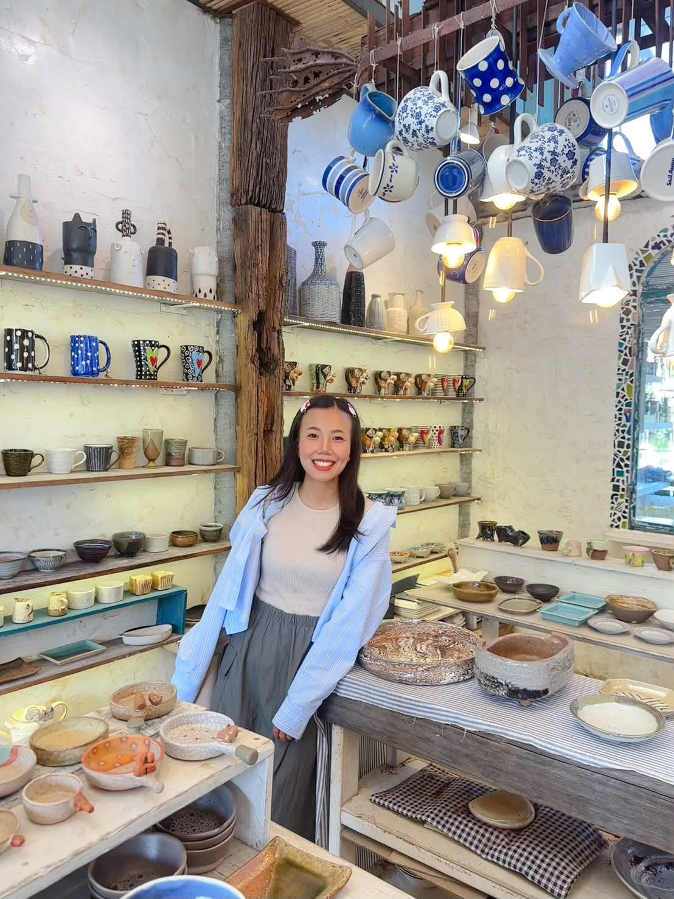

---
project:
  type: website

website:
  title: "My Life Dashboard"

format:
  html:
    theme: cosmo
    css: custom.css
    page-layout: full
---

```{r}
#| echo: false
#| warning: false
#| message: false

library(dplyr)
library(ggplot2)
library(readr)
library(scales)
library(plotly)
library(DT)

career_data <- read_csv(
  "data/career_data.csv",
  show_col_types = FALSE
)
courses_data <- read_csv(
  "data/courses_data.csv",
  show_col_types = FALSE
)

valid_courses <- courses_data |>
  filter(
    !is.na(course), course != "",
    !is.na(category), category != ""
  )

project_summary <- career_data |>
  filter(!is.na(year), !is.na(project), project != "") |>
  group_by(year) |>
  summarise(
    total_projects = n_distinct(project),
    .groups = "drop"
  ) |>
  arrange(year)

experience_summary <- career_data |>
  filter(!is.na(role), !is.na(duration_years)) |>
  group_by(role) |>
  summarise(
    total_years = sum(duration_years, na.rm = TRUE),
    .groups = "drop"
  )

skills_summary <- career_data |>
  filter(!is.na(skill), skill != "") |>
  count(skill, name = "total_projects") |>
  arrange(skill) |>
  mutate(
    share = total_projects / sum(total_projects),
    label = paste0(round(share * 100), "%")
  )

course_summary <- valid_courses |>
  count(category, name = "total_courses")
```

# My Life Dashboard

My personal journey in education, career, skills, and professional development

::::::: dashboard-header
::: header-profile
{.profile-photo}
:::

:::: header-info
# NUTTANAN SAE-WEE

**International College of Digital Innovation, Chiang Mai University**

Student ID: **622415007**

Data Updated: **24 October 2026**

::: social-links
[Instagram](https://www.instagram.com/ssmile.nsw?utm_source=ig_web_button_share_sheet&obrf=ZDNlZDc0MzIxNw==)
:::
::::

::: header-logo
{.icdi-logo}
:::
:::::::

## Overview

::::::: kpi-row
::: kpi-card
### 💼

**Experience**

# 5 Years

Professional Experience
:::

::: kpi-card
### 🛠

**Skills**

# 5

Unique Skills
:::

::: kpi-card
### 📚

**Courses**

# `r nrow(valid_courses)`

Key Courses
:::

::: kpi-card
### 🎯

**Focus**

# Business Development

Career Direction
:::
:::::::

::::: columns
::: {.column width="50%"}
## Experience

```{r}
#| echo: false
#| message: false
#| warning: false

p <- ggplot(
  experience_summary,
  aes(
    x = reorder(role, total_years),
    y = total_years,
    text = paste0(
      "Role: ", role,
      "<br>Years of Experience: ", total_years
    )
  )
) +
  geom_col(fill = "#A98467", width = 0.4) +
  geom_text(
    aes(label = paste0(total_years, " years")),
    hjust = -1,
    size = 3.5,
    color = "#5B4434"
  ) +
  coord_flip(clip = "off") +
  scale_y_continuous(
    breaks = scales::breaks_pretty(),
    expand = expansion(mult = c(0, 0.25))
  ) +
  labs(
    title = "",
    x = "Career Role",
    y = "Years of Experience"
  ) +
  theme_minimal(base_size = 12) +
  theme(
    plot.title = element_text(
      face = "bold",
      color = "#75543B",
      hjust = 0.5
    ),
    plot.background = element_rect(
      fill = "transparent", color = NA
    ),
    panel.background = element_rect(
      fill = "transparent", color = NA
    ),
    plot.margin = margin(10, 25, 10, 10)
  )

plotly::ggplotly(p, tooltip = "text")
```

**Key Insight:** The role(s) with the longest experience is/are `r if (nrow(experience_summary) > 0) paste(experience_summary$role[experience_summary$total_years == max(experience_summary$total_years)], collapse = ", ") else "not available"`, with `r if (nrow(experience_summary) > 0) max(experience_summary$total_years) else 0` year(s) of experience.
:::

::: {.column width="50%"}
## Introduction Video

Personal Growth & Self-Improvement

Small habits that make a big difference in physical health, mental well-being, energy, and daily productivity.

Why Not Be Better You?

Explore 7 simple habits and practical exercises to build a healthier, happier, and more productive lifestyle.

<iframe
  width="100%"
  height="315"
  src="https://www.youtube.com/embed/QoKMrQV5NQA"
  title="Why Not Be Better You | 7 Small Habits to Improve Your Life"
  frameborder="0"
  allow="accelerometer; autoplay; clipboard-write; encrypted-media; gyroscope; picture-in-picture; web-share"
  allowfullscreen>
</iframe>
:::
:::::

::::: columns
::: {.column width="50%"}
## Skills Overview

```{r}
#| echo: false
#| warning: false
#| message: false

if (nrow(skills_summary) > 0) {

  skill_colors <- c(
    "Communication" = "#A98467",
    "Negotiation" = "#D8BFA3",
    "Leadership" = "#E8C9B9",
    "Strategic Planning" = "#B7C4A0",
    "Digital Marketing" = "#8797A5"
  )

  skills_plot_data <- skills_summary |>
    mutate(
      skill = trimws(as.character(skill))
    ) |>
    filter(skill %in% names(skill_colors)) |>
    mutate(
      skill = factor(skill, levels = names(skill_colors)),
      share = total_projects / sum(total_projects),
      label = paste0(round(share * 100), "%"),
      skill_label = paste0(skill, "\n", label)
    ) |>
    arrange(skill)

  ggplot(
    skills_plot_data,
    aes(x = 2, y = share, fill = skill)
  ) +
    geom_col(
      width = 0.85,
      color = "#FAF5EC",
      linewidth = 1.2,
      position = position_stack(reverse = TRUE)
    ) +
    geom_text(
      aes(label = skill_label),
      position = position_stack(vjust = 0.5, reverse = TRUE),
      color = "#5B4434",
      fontface = "bold",
      size = 3
    ) +
    coord_polar(theta = "y") +
    xlim(0.5, 2.8) +
    scale_fill_manual(
      name = "Skills",
      values = skill_colors,
      breaks = names(skill_colors),
      limits = names(skill_colors),
      drop = FALSE
    ) +
    labs(title = "") +
    theme_void() +
    theme(
      plot.title = element_text(
        face = "bold",
        color = "#75543B",
        hjust = 0.5,
        size = 14
      ),
      legend.position = "right",
      legend.text = element_text(
        color = "#5B4434",
        size = 10
      ),
      legend.title = element_text(
        color = "#75543B",
        face = "bold"
      ),
      plot.margin = margin(20, 30, 20, 30)
    )

} else {

  ggplot() +
    annotate(
      "text",
      x = 0,
      y = 0,
      label = "No skill data available"
    ) +
    theme_void()

}
```

**Key Insight:** `r if (nrow(skills_summary) > 0) paste(skills_summary$skill[skills_summary$total_projects == max(skills_summary$total_projects)], collapse = ", ") else "No skill data available"` is associated with the highest number of records in the dataset.
:::

::: {.column width="50%"}
## Courses Overview

Number of courses completed across selected categories.

```{r}
#| echo: false
#| warning: false
#| message: false

if (nrow(course_summary) > 0) {

  ggplot(
    course_summary,
    aes(
      x = reorder(category, -total_courses),
      y = total_courses
    )
  ) +
    geom_col(fill = "#A98467", width = 0.6) +
    geom_text(
      aes(label = total_courses),
      vjust = -0.4,
      color = "#5B4434",
      size = 3.5
    ) +
    scale_y_continuous(
      breaks = scales::breaks_pretty(),
      expand = expansion(mult = c(0, 0.2))
    ) +
    labs(
      title = "Courses by Category",
      x = "Course Category",
      y = "Number of Courses"
    ) +
    theme_minimal(base_size = 12) +
    theme(
      plot.title = element_text(
        face = "bold",
        color = "#75543B",
        hjust = 0.5
      ),
      axis.text = element_text(color = "#5B4434"),
      axis.title = element_text(color = "#5B4434"),
      panel.grid.minor = element_blank()
    )

} else {
  ggplot() +
    annotate(
      "text",
      x = 1,
      y = 1,
      label = "No course data available"
    ) +
    theme_void()
}
```

**Key Insight:** The category with the most courses is `r if (nrow(course_summary) > 0) paste(course_summary$category[course_summary$total_courses == max(course_summary$total_courses)], collapse = ", ") else "not available"`.
:::
:::::

## Course Data Explorer

Explore the course records using search, sorting, and pagination.

```{r}
#| echo: false
#| message: false
#| warning: false

DT::datatable(
  valid_courses |> select(course, category),
  caption = "Table 1: Courses completed, grouped by course category.",
  rownames = FALSE,
  colnames = c("Course", "Category"),
  options = list(
    pageLength = 6,
    searching = TRUE,
    ordering = TRUE,
    lengthChange = FALSE,
    info = TRUE
  )
)
```
